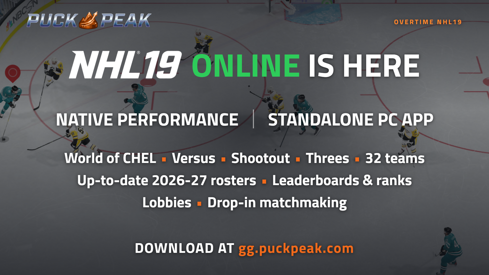

# 🏒 OVERTIME: NHL 19 Online on PC

### Play **NHL 19** on your Windows PC, online again, with today's rosters.
*One standalone app sets up the game, runs it and gets you into online matches. Brought to you by [Puck Peak](https://www.puckpeak.com).*

[**⬇ Download the latest version**](../../releases/latest)
&nbsp;·&nbsp; [Quick start](QUICKSTART.md) &nbsp;·&nbsp; [What's new](CHANGELOG.md)

Questions, news and help: **[gg.puckpeak.com](https://gg.puckpeak.com)**

## ✨ What you get

- 🖥 **A standalone PC app.** Download one exe, point it at your NHL 19 (its folder or the PKG) and press
  **Play NHL 19**. The app installs the game from a PKG if needed, downloads the emulator it plays on and keeps it
  up to date. Nothing else to install or configure by hand.
- ⚡ **Native performance.** NHL 19 runs on **Overtime Native**, our build of the shadPS4 emulator tuned for this game:
  unlocked frame rate, 720p / 1080p / 1440p, borderless fullscreen, steadier frames. Kravickas's NHL 19 build is one
  click away on the same card.
- 🌐 **Online again.** EA switched NHL 19's servers off; Overtime runs a community server in Europe with a relay in
  North America.
  **World of CHEL** (drop-in 6s, 3s, clubs, Ones), **Versus**, **Shootout** and **Threes** work from the game's own
  menus, with drop-in matchmaking.
- 🎮 **Lobbies, ranks and leaderboards.** Host or join a lobby with a friend, the host picks Versus, Shootout or
  Threes and the rules, both press Ready and the app starts the match. Every human game counts toward your rank, with match history, live matches,
  lobby chat and a ping readout in the corner of the game.
- 🏟 **32 teams and the 2026-27 season.** The Seattle Kraken and Utah in Play Now, Be a Pro and a 32 Team Expansion
  Draft Franchise; up-to-date rosters for the NHL, AHL and the European leagues; the real NHL, AHL and Liiga calendars.
  Online games download the current online roster by themselves.
- 👕 **Today's look.** NHL 27 kits and equipment, NHL.com photos and logos, club logos and kits: optional packs, one
  Download button each.
- ✏️ **A full roster editor.** Players, numbers, ratings, lines, strategies, jerseys and gear, contracts and the
  salary cap, free agents. Save stops only what would corrupt the roster or crash the game.
- 🎛 **Controllers and keyboard.** Map any pad, or play on keyboard and mouse, from inside the app.
- 🔒 **Safe.** Your game files are only read, every save is backed up first, and **Unpatch** puts everything back.
  The app updates itself.

 
 
 
 

## 🚀 Get started

1. Download `OvertimeNHL19.exe` (Windows 10 or 11) from the [release page](../../releases/latest) and start it.
   Windows SmartScreen warns because the exe is not signed: choose **More info**, then **Run anyway**.
2. **Setup → Find game**: pick your NHL 19 folder (its `eboot.bin`) or the game PKG. The app installs a PKG for you.
3. **Game patch → Patch**, then the green **Play NHL 19** button. The first press downloads the emulator.
4. For online play, sign in or sign up for ShadNet on the **Multiplayer** tab, then press PLAY in any online mode or
   join a lobby.

Step by step: [QUICKSTART.md](QUICKSTART.md).

## What you need

- A Windows 10 or 11 PC with a graphics card that runs NHL 19 in shadPS4, and about 10 GB of free memory while playing.
- Your own NHL 19: **CUSA11126 with update 1.60** (a game folder or the PKGs). The app refuses other versions.
- A free **ShadNet** account for online play (made inside the app).

## How it works

| Part | What it does |
|---|---|
| `overtime_roster/` | The desktop app (pywebview + `web/`): setup, PKG install, emulator builds, game patch, roster update and editor, multiplayer |
| `overtime_core/` | The NHL 19 roster codec, schema, verify rules, calendars, art packs and the patch builder |
| `patches/`, `client/` | The game patch that points NHL 19 at the Overtime servers, and the replacement connection texts |
| `packaging/` | The PyInstaller build of `OvertimeNHL19.exe` |

The game patch and data changes go into overlay folders next to the game; the game folder itself is only ever read.
The roster app reads the game's own data from your copy at runtime. The emulator builds the app downloads are
GPL-2.0: Overtime Native's source is at [MatusRiedl/shadPS4](https://github.com/MatusRiedl/shadPS4/tree/overtime-nightly)
(branch `overtime-nightly`), Kravickas's at [Kravickas/shadPS4](https://github.com/Kravickas/shadPS4).

For developers: [AGENTS.md](AGENTS.md).

## What this project does not ship

No game files, eboot, archives, certificates or extracted EA assets are in this repository or in the app. You need
your own legally obtained copy of NHL 19.

## Disclaimer

Overtime is an unofficial fan project by [Puck Peak](https://www.puckpeak.com). It is not affiliated with, endorsed
by or sponsored by Electronic Arts, EA SPORTS, the NHL, the NHLPA, the AHL, the Liiga or any team. All trademarks
belong to their owners. No money is made from this project. Official AHL statistics are provided by the American
Hockey League.

## License

[MIT](LICENSE). Bundled: React and htm (MIT, `overtime_roster/web/vendor/LICENSES.txt`) and the Titillium Web font (SIL Open Font License,
`overtime_roster/web/fonts/OFL.txt`).
